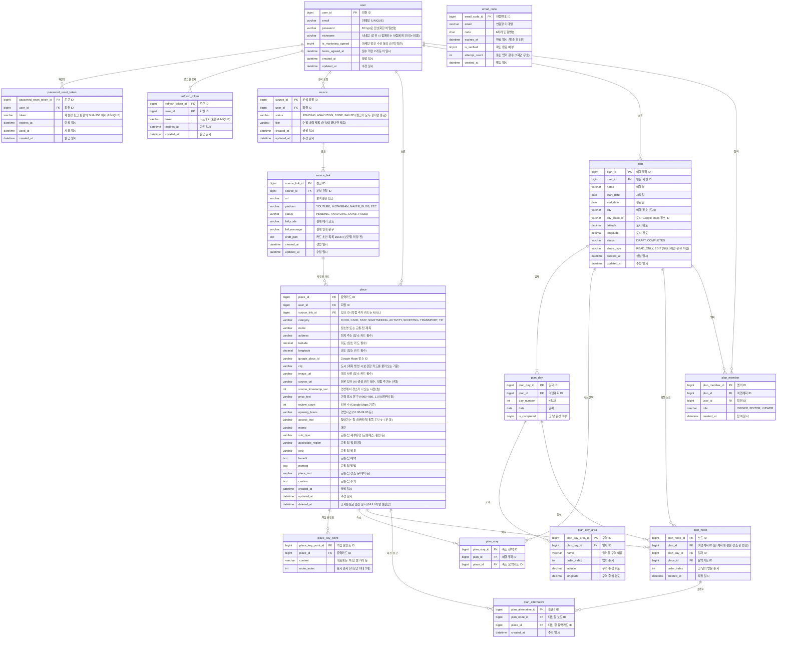

# Wayvi ERD (BE 규칙 문서 기준)

- 수정일: 2026-11-10
- 기준: `ReelTrip-BE-AGENTS.md`(엔티티 이름, 카테고리 키, 상태 값, 화면별 API 초안), 와이어프레임 S0-1b·S2-0·S4-3, Figma 디자인(Figma 디자인, 2026-11-10)
- ERDCloud용 파일: [schema.sql](schema.sql), [schema.sql](schema.sql) (내용은 같고 SQL 형식만 다름)
- 이름 규칙: 테이블·컬럼은 스네이크 케이스 단수형, PK는 `{도메인}_id`. API 필드 `placeId`, 레포지토리 `findByPlaceId`와 맞춘 것입니다.

## 다이어그램

## 테이블과 엔티티

| 테이블 | 엔티티 | 역할 | 근거 |
| --- | --- | --- | --- |
| `user` | `User` | 이메일 계정, 닉네임, 약관 동의 | S0-1b, 회원·인증 규칙 |
| `email_code` | `EmailCode` | 6자리 인증번호와 만료 시각 | "인증번호는 DB에 만료 시각과 함께 저장" |
| `password_reset_token` | (가정) | 비밀번호 재설정 링크 토큰 | 재설정 링크 발송 규칙. 저장 방식은 문서에 없음 |
| `refresh_token` | (가정) | 로그인 상태 유지 토큰 | 리프레시 토큰 규칙. 저장 방식은 문서에 없음 |
| `source` | `Source` | 분석 요청 한 번 | 폴더 구조 `source/entity` |
| `source_link` | `SourceLink` | 링크 하나와 그 상태, 카드 초안 | 링크 분석 흐름 |
| `place` | `Place` | 요약카드. 장소 6종과 교통·팁을 함께 담음 | S2-0, 요약카드 규칙 |
| `place_key_point` | (컬렉션) | 카드당 최대 3개의 핵심 포인트 | `MAX_KEY_POINTS` |
| `plan` | `Plan` | 여행명, 기간, 도시, 상태, 공유 설정 | 여행계획 규칙 |
| `plan_day` | `PlanDay` | 일자와 완성 여부 | 여행계획 규칙 |
| `plan_day_area` | (컬렉션) | 그 날 둘러볼 구역 이름 목록 | S4-4, `PUT .../areas` |
| `plan_stay` | `PlanStay` | 계획에서 고른 숙소 카드 목록 | S4-3, `PUT /plans/{planId}/stays` |
| `plan_node` | `PlanNode` | 확정한 노드와 순서 | S4-5 |
| `plan_alternative` | `PlanAlternative` | 플랜B. 대신할 노드와 대신 갈 카드 | S4-5c-3 |
| `plan_member` | `PlanMember` | 소유자·편집·읽기 멤버 | S4-8, 공유 규칙 |

## 제약·인덱스

- `user.email` 유니크.
- `email_code (email, created_at)` 인덱스. 가장 최근 인증번호만 유효합니다. 틀린 입력은 `attempt_count`로 세고 5회면 그 번호를 무효로 합니다(2026-11-12 추가).
- `password_reset_token.token`에는 링크에 넣은 값이 아니라 SHA-256 해시를 저장합니다. 30분, 1회용(`used_at`).
- `password_reset_token.token`, `refresh_token.token` 유니크.
- `place (user_id, category)`, `place (user_id, city)` 인덱스. 보관함 필터와 계획 생성 시 도시 카드 불러오기에 씁니다.
- `source (user_id, created_at)` 인덱스. 링크 홈의 "최근 수집 내역"에 씁니다.
- `plan_day (plan_id, day_number)` 유니크.
- `plan_stay (plan_id, place_id)` 유니크.
- `plan_node (plan_id, place_id)` 유니크. "같은 장소 카드는 한 계획 안에서 한 번만 확정" 규칙입니다.
- `plan_node (plan_day_id, order_index)` 인덱스. 그 날의 순서를 통째로 받아 다시 매깁니다.
- `plan_member (plan_id, user_id)` 유니크.
- `plan_alternative`는 대신할 노드가 지워지면 함께 지웁니다(`ON DELETE CASCADE` 또는 서비스에서 처리).

## 서버에서 검사할 규칙

- 장소 카드(`Category.isPlace()`가 참)는 `address`, `latitude`, `longitude`, `image_url`이 필수입니다. 교통·팁 카드는 `sub_type`, `applicable_region`이 필수입니다. 컬럼은 둘 다 NULL 허용이라 서비스에서 검사합니다.
- `source_url`은 AI가 만든 카드(`source_link_id`가 있음)에서만 필수입니다.
- 핵심 포인트는 카드당 최대 3개입니다.
- 닉네임은 1~8자입니다(디자인 온보딩 안내 문구). 컬럼은 `VARCHAR(30)` 그대로 둡니다.
- 구역 주변 카드는 `plan_day_area`의 좌표에서 반경 안에 있는 내 장소 카드를 거리 계산으로 고릅니다. 반경 값은 미정입니다.
- `price_text`는 화면에 그대로 보여 주는 문구입니다. 서버는 계산에 쓰지 않습니다.
- 교통·팁 카드는 `plan_node`, `plan_stay`, `plan_alternative`에 넣을 수 없습니다.
- `plan_stay`에는 `STAY` 카테고리 카드만 넣습니다.

## 이전 초안에서 바뀐 것

| 이전 | 지금 | 이유 |
| --- | --- | --- |
| `users` | `user` (+ `is_marketing_agreed`, `terms_agreed_at`, `updated_at`) | 단수형 규칙, 약관 동의. `nickname`은 필수로 변경, `deleted_at` 삭제 |
| 없음 | `email_code`, `password_reset_token`, `refresh_token` | 이메일 인증, 비밀번호 재설정, 로그인 유지 |
| `sources` | `source` + `source_link` | 요청 한 번에 링크 여러 개. 상태는 `ANALYZING` |
| `cards` | `place` | 엔티티 `Place`. 교통·팁 항목을 같은 테이블로 합침 |
| `cards.status` (DRAFT/SAVED) | `source_link.draft_json` | 초안은 보관함에 넣지 않고 "모두 저장" 때 `place`로 저장 |
| `cards.price_text` | `place.price_text` | 한때 숫자·통화 코드로 나눴다가 디자인에 맞춰 문구 하나로 되돌림 (아래 표) |
| `cards.rating` | 삭제 | 디자인에 평점이 없음 |
| `cards.review_count`, `opening_hours` | `place.review_count`, `place.opening_hours` | 디자인 카드에 보임 (아래 표) |
| 없음 | `place.source_timestamp_sec` | 영상에서 장소가 나오는 시점 저장 |
| `card_highlights` | `place_key_point` | 이름을 코드 상수에 맞춤 |
| `card_info_details` | `place`의 컬럼 7개 | 엔티티가 `Place` 하나 |
| `plans.status` DRAFTING | `DRAFT` | 문서의 상태 값 |
| `plans.share_token`, `share_permission` | `plan.share_type` | 공유 주소가 `/plan/{planId}`라 토큰이 필요 없음 |
| `plan_days.accommodation_card_id` | `plan_stay` | 숙소는 계획 단위로 여러 개 선택 |
| `plan_days.area_name` 등 | `plan_day_area` | 구역은 일자마다 여러 개 |
| `plan_nodes.main_node_id` | `plan_alternative` | 플랜B는 별도 엔티티 |
| `plan_nodes.sort_order` | `plan_node.order_index` | 문서의 필드 이름 |
| `plan_routes` | 삭제 | 경로는 Google Maps 결과를 잠깐만 저장해 재사용. 테이블로 둘지는 미정 |
| `plan_members.role` VIEWER/EDITOR | OWNER/EDITOR/VIEWER | 문서의 역할 값 |
| 모든 PK `id` | `{도메인}_id` | API 필드 `placeId` 규칙과 맞춤 |

## Figma 디자인을 보고 바꾼 것 (2026-11-10)

| 대상 | 변경 | 디자인 근거 |
| --- | --- | --- |
| `source` | `title` 추가 | 링크 홈 "최근 수집 내역"에 날짜와 제목("오사카 여행 플랜")이 보임 |
| `place` 가격 | `price_amount`·`price_currency`·`is_price_from` → `price_text` | 카드의 "¥960~980", 직접 추가의 자유 입력 "1,078엔부터"(50자) |
| `place` | `review_count`, `opening_hours`, `access_text` 추가 | 카드의 "6,500 Reviews", "11:00-24:00", "하카타역 동쪽 도보 약 6~7분" |
| `plan_day_area` | `latitude`, `longitude` 추가 | 구역을 검색하면 그 주변 저장 카드만 보이고, 없으면 "오사카성 주변에는 저장한 장소가 없어요" |

- 메일 인증(`email_code`), 약관 동의, 비밀번호 재설정은 디자인에 화면이 없지만 그대로 둡니다. 메일 인증은 유지하기로 정했습니다.
- 소셜 로그인은 디자인에도 없고 만들지 않습니다.
- 여행목록의 커버 사진은 컬럼을 두지 않고 그 계획 첫 노드의 카드 사진을 씁니다.
- 계획 지도의 "팁" 탭은 그 도시의 교통·팁 카드를 조회만 합니다. 노드로 넣을 수 없다는 규칙은 그대로입니다.

## 확인이 필요한 것

- `user`는 H2 등 일부 DB에서 예약어입니다. 테스트 DB에 따라 `@Table(name = "users")`가 필요할 수 있습니다.
- `password_reset_token`, `refresh_token`은 문서에 저장 방식이 없어 넣은 가정입니다.
- 카드 초안을 `source_link.draft_json`에 두는 것도 가정입니다. 문서에는 "초안은 보관함에 바로 넣지 않는다"와 "분석 상태는 DB에만 저장"만 있습니다.
- 읽기 전용 링크와 함께 편집 링크를 동시에 둘 수 있는지는 문서에 없어 `share_type` 하나로 두었습니다.
- 경로 캐시를 DB에 둘지 여부.
- 회원가입 디자인에 인증번호 입력·약관 동의 화면이 없습니다. 디자인에 추가가 필요합니다.
- 가격을 문구 하나(`price_text`)로 둔 것은 BE 규칙 문서의 가격 형식(`amount`, `currency`, `isFrom`)과 다릅니다. FE와 합의가 필요합니다.
- `review_count`, `opening_hours`, `access_text`는 Google Maps 장소 정보로 채우는 것을 가정했습니다. 직접 추가 카드에서 어떻게 채울지는 미정입니다.
- `source.title`은 초안에서 가장 많이 나온 도시로 "{도시} 여행"을 만들기로 정했습니다([api-spec.md](api-spec.md) "링크 분석 설계").
- 구역 주변 카드를 고르는 반경 값.
